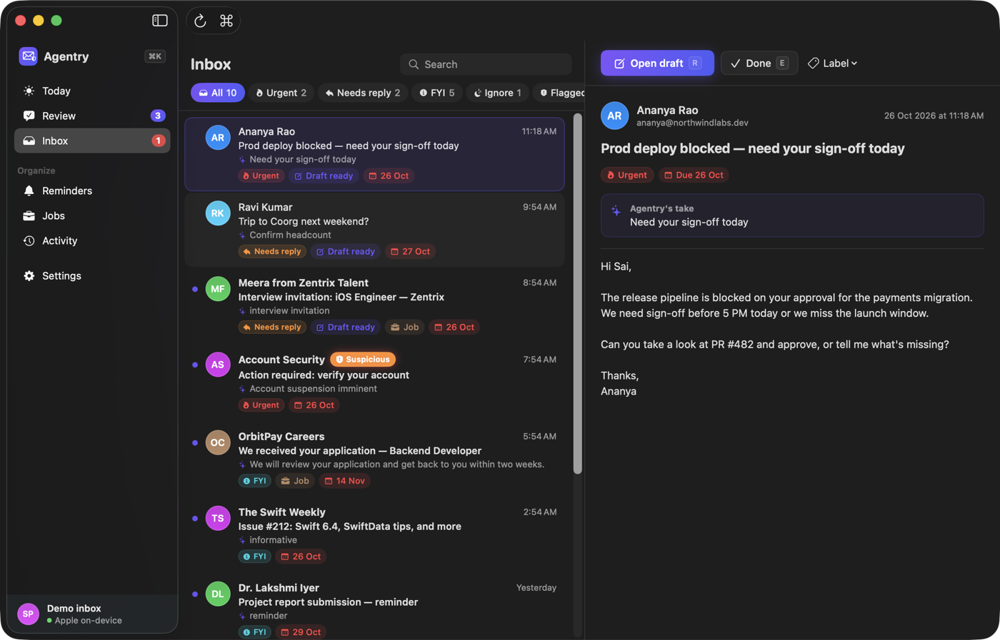
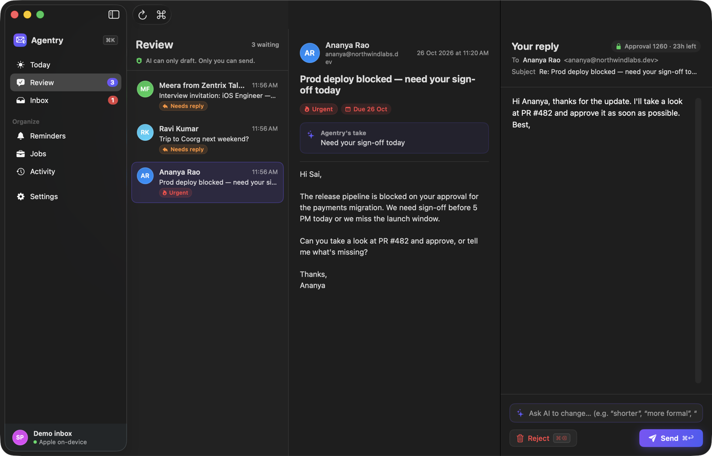
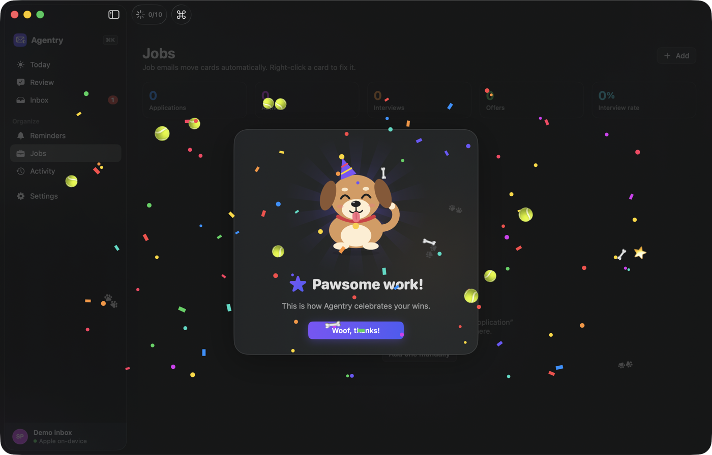

# Agentry

**A simple, free, private email assistant for Mac.** Agentry lives in your menu bar, reads your Gmail, tells you what matters, drafts replies in your style, and **never sends anything without your click**.

Built with Swift 6, SwiftUI, SwiftData, Apple Foundation Models (on-device AI) and the Gmail REST API. Budget: ₹0.



| Review & approve | Celebrations |
|---|---|
|  |  |

---

## What it does

| Feature | What you get |
|---|---|
| **Triage** | Every new email is labeled *urgent / needs reply / FYI / ignore*, with a one-line reason and any deadline |
| **Draft replies** | For urgent and needs-reply emails, a Gmail draft written in your style (using 1–2 of your sent emails as examples) |
| **Approve before sending** | Review screen + actionable notifications with **Send / Edit / Reject**, then a 30-second **Undo** |
| **Guard** | Pattern rules + an AI check catch prompt injection and phishing. Flagged emails get a ⚠️ badge and no automatic draft |
| **Reminders** | "Remind me Friday at 4 to call Ravi" → confirm → notification with **Done / Snooze 1h**. Missed ones show as *late* |
| **Today briefing** | Urgent mail, drafts waiting, today's reminders and job updates, plus an optional morning notification |
| **Job tracker** | Job emails (applied, assessment, interview, rejected, offer) move cards on a pipeline board automatically |
| **Activity** | A log of everything Agentry did |
| **Celebrations** | Animated cats & dogs (with confetti) when you hit Inbox Zero, send replies, land interviews, or block a phishing email |

### Feels like a pro mail app

- **Keyboard first:** `⌘K` command palette · `⌘1–7` switch screens · `J`/`K` move · `E` done · `R` reply · `1–4` correct label · `⌘↩` send · `⌘⌫` reject · `⌘Z` undo send · `?` all shortcuts
- **Motion:** label chips fade in, sent drafts slide out, the Undo bar shrinks over 30 s, Today's numbers count up. All motion goes through `DesignSystem/Motion.swift` and respects **Reduce Motion**
- Native Light/Dark mode, SF Symbols, menu bar popover with a badge for drafts waiting
- **Demo inbox** so you can try everything before connecting Gmail

### Your own cat & dog videos 🐱🐶

Celebrations use hand-drawn vector cats and dogs, so nothing needs downloading. To use real clips instead, drop `.mp4`/`.mov` files into:

```
~/Library/Application Support/Agentry/Celebrations/cats/
~/Library/Application Support/Agentry/Celebrations/dogs/
```

Settings → Celebrations → **Open videos folder** takes you there. Clips play muted and looped.

---

## The one safety rule

> **The AI can only create drafts. It can never send.**

Sending lives in one small plain-Swift type, [`SendService`](Services/SendService.swift). It runs only when:

1. you clicked **Send** (Review screen or notification),
2. the draft's one-time `approvalID` is valid, unused, and less than 24 hours old,
3. the draft's body hash matches what you approved (any edit issues a new approval),
4. the 30-second Undo window passed without you cancelling.

`TriageService`, `WriterService`, `GuardService` and `AIService` have no reference to `SendService` or the `DraftSending` protocol. A test (`aiServicesHaveNoPathToSending`) checks this. Even if an email tricks the AI, the worst case is a bad draft that you reject.

---

## Free setup

### 1. Run it

1. Open `Agentry.xcodeproj` in Xcode (26 or newer).
2. Select the **Agentry** scheme and press **⌘R**. It is signed to run locally; no paid developer account is needed. To use your free Apple ID instead, pick your *Personal Team* under *Signing & Capabilities*.
3. Pick **Try the demo inbox** to explore right away.

Minimum macOS 14. Apple's on-device model needs macOS 26 on Apple Silicon with Apple Intelligence turned on.

### 2. Use your real Gmail through Apple Mail (recommended, no Google sign-in)

1. **System Settings → Internet Accounts → Google** and sign in once there, with **Mail** turned on. (Already using Gmail in the Mail app? Skip this.)
2. In Agentry, choose **Use Apple Mail** (onboarding or Settings → Account).
3. When macOS asks *"Agentry wants to control Mail"*, click **OK**. If you clicked *Don't Allow*, go to System Settings → Privacy & Security → **Automation** → Agentry → turn on **Mail**.

How it works: Agentry reads your inbox through Mail, keeps drafts inside Agentry for review, and when you approve (after the 30 s Undo) Mail sends the reply. There's no Google Cloud project, no tokens in Agentry, and no 7-day logout. Pick the sending address in Settings → Account → **Send from**. Mail must be able to run, but it doesn't need to stay open.

### 2b. Or connect Gmail directly (advanced, Testing mode)

1. Go to [console.cloud.google.com](https://console.cloud.google.com) and create a project (no billing needed).
2. **APIs & Services → Library →** enable the **Gmail API**.
3. **OAuth consent screen:** choose *External*, fill in the app name, leave it in **Testing**, and under **Test users** add your own Gmail address. Under *Data access*, add the scopes `.../auth/gmail.readonly` and `.../auth/gmail.compose`.
4. **Credentials → Create credentials → OAuth client ID →** type **iOS** (this is what Google uses for native Mac apps), bundle ID `com.saipranav.Agentry`.
5. Copy the client ID (`1234-abc.apps.googleusercontent.com`) into Agentry → **Settings → Account** (or the onboarding screen) and click **Sign in with Google**.

Login uses OAuth with PKCE through `ASWebAuthenticationSession`: no client secret, no SDK. Tokens are stored in the **macOS Keychain**, never in files or git. The client ID is public by design and is stored in UserDefaults.

### 3. AI (all free, all local)

| Option | When | Setup |
|---|---|---|
| **Apple Foundation Models** (default) | macOS 26, Apple Silicon, Apple Intelligence on | None. Uses `@Generable` structs for guaranteed structured output |
| **Ollama** (fallback) | Older macOS, Intel, or a bigger model | `brew install ollama && ollama pull llama3.2:3b && ollama serve` |
| **Basic rules** | Neither available | None. Keyword rules so the app still works |

Agentry checks `SystemLanguageModel.default.availability` at launch and falls back automatically; Settings lets you switch manually. Prompts are kept short for Apple's ~4k-token window: quoted replies and signatures are stripped, emails are trimmed, and long ones go to Ollama when it's running. Email text is always wrapped in `<email_data>` with an instruction that it is data, not instructions. Prompts live in [`Prompts/`](Prompts).

### 4. Launch at login

Settings → Schedule → **Open Agentry when you log in** (uses `SMAppService`).

---

## How it works

```
Every N minutes (default 5) and when the Mac wakes:
  new Gmail messages (history IDs)
    → Guard     rules first; one AI check if a rule matched or the sender is new
    → Triage    one AI call: label, reason, deadline, job info
    → JobTracker  add/update application (no duplicates, stages only move forward)
    → if urgent / needs reply and not flagged:
          Writer creates a Gmail DRAFT → notification [Send] [Edit] [Reject]
    → you click Send → 30 s Undo → SendService sends the draft

Every 30 s: deliver due reminders (late ones marked) + morning briefing check
```

## Project structure

```
App/            AgentryApp (MenuBarExtra + window), AppState (wiring), AppSettings
Services/       GmailService, DemoMailService, AIService, TriageService, WriterService,
                GuardService, SendService, PollingService, NotificationService,
                ReminderService, BriefingService, JobTracker, AchievementCenter, EvalMetrics
Models/         SwiftData: Email, Draft, Reminder, JobApplication, ActivityEntry
Views/          Today, Review, Inbox, Reminders, Jobs, Activity, Settings, MenuBar, Onboarding
Views/Components  chips, cards, Undo bar, ⌘K palette, animated pets, confetti
DesignSystem/   Motion.swift (animation tokens), Theme.swift
Prompts/        triage.txt, writer.txt, guard.txt, reminder.txt
AgentryTests/   unit tests + evals (Swift Testing)
```

---

## Evaluation

Run all tests and evals with **⌘U** in Xcode, or:

```bash
xcodebuild -project Agentry.xcodeproj -scheme Agentry test
```

Numbers measured on a MacBook (Apple Silicon, macOS 26):

| Eval | Result | Target |
|---|---|---|
| **Injection detection**: 20 tricky + 20 normal synthetic emails | **20/20 caught (100%)**, **0/20 false alarms (0%)** | > 90% caught, < 5% false alarms |
| **SendService safety**: expired, reused, changed drafts; nothing sent during Undo | all refused / pass | must pass |
| **Triage accuracy on your labels** | appears once you label emails | > 85% |
| **Draft acceptance rate** | shown live in Settings → Evaluation | goes up over time |

**Triage backend comparison** (30 synthetic emails in `AgentryTests/Fixtures/triage_eval.json`):

| Backend | Label accuracy | Job stage accuracy | Speed |
|---|---|---|---|
| Apple on-device (Foundation Models) | 83% | 100% | ~1.1 s/email |
| Basic rules (no AI) | 97%* | 100% | instant |
| Ollama | not measured (not installed on the test Mac) | | |

\* The basic rules and the synthetic set were written by the same person, so this number is optimistic. The real measure is your own mail: right-click → **Correct label** (or press `1–4`) on ~100 Gmail emails. Your labels are saved to `~/Library/Application Support/Agentry/eval/triage_labels.json` (never in the repo), and the `triageAccuracyOnSavedLabels` eval reports the accuracy.

To compare backends yourself (runs Apple's model and Ollama when available):

```bash
TEST_RUNNER_AGENTRY_COMPARE_BACKENDS=1 TEST_RUNNER_AGENTRY_EVAL_VERBOSE=1 \
  xcodebuild -project Agentry.xcodeproj -scheme Agentry test \
  -only-testing:"AgentryTests/EvalTests/backendComparison()"
```

---

## Known limits

- In Google's **Testing** mode, login expires about every **7 days**. Agentry detects this and shows a *Sign in again* notification.
- Agentry only works while your Mac is on and the app is running. On wake it catches up on missed mail and marks missed reminders as *late*.
- Approvals happen on your Mac only (no phone approvals yet).
- The app isn't notarized (that needs a paid account), so other people need to click **Open Anyway** in System Settings → Privacy & Security the first time.
- Apple's on-device model is small. It is good at labels but sometimes calls an urgent email "needs reply"; correct it with `1–4` and it shows up in your eval.

## Privacy

No servers and no paid APIs: everything runs on your Mac. Mail is fetched straight from Google to your Mac, AI runs on-device (or on your local Ollama), and data is stored in `~/Library/Application Support/Agentry/`. Tokens live in the Keychain. The repo contains no personal data or tokens; `.gitignore` blocks stores and label exports.

## Later (one at a time)

Telegram approvals · calendar suggestions for "can we meet?" · follow-up nudges after 3 days · Glink command · business payment reminders. Every new action still goes through the same approval rule.

---

© 2026 B. Sai Pranav
